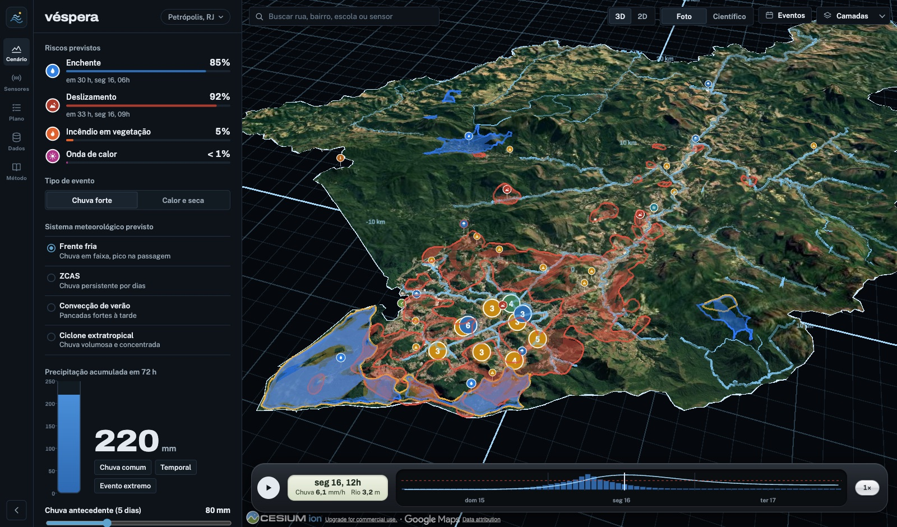
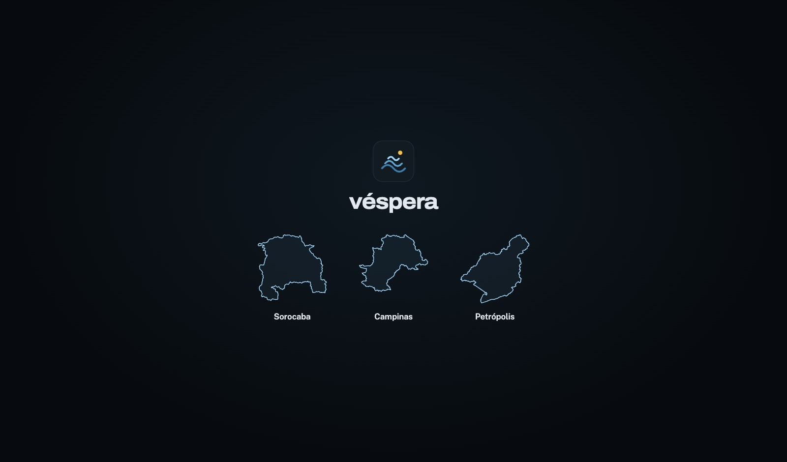
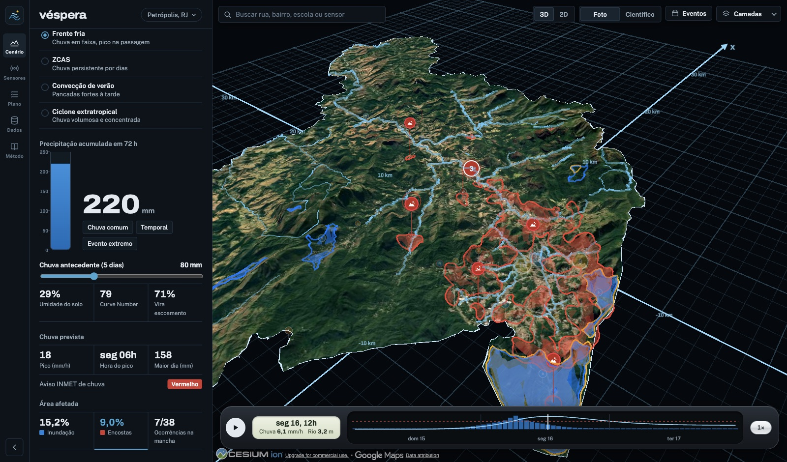
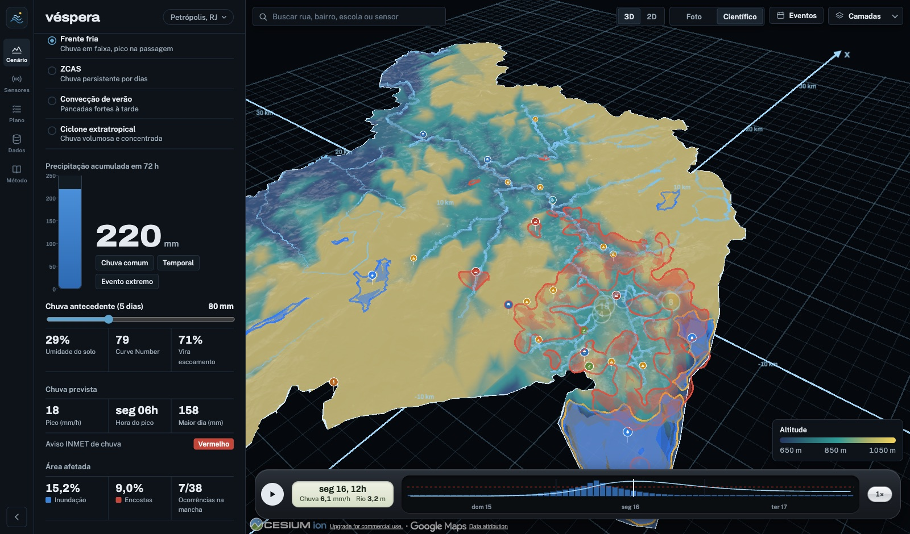

# véspera

Previsão de enchente, deslizamento, incêndio em vegetação e onda de calor para a Defesa Civil, em 3D, em três cidades: Sorocaba (SP), Campinas (SP) e Petrópolis (RJ).

Trabalho em grupo do curso de Engenharia de IA da FIA. O cliente é fictício; os dados das cidades são reais.

**No ar:** https://vespera-ia.vercel.app



## O que ele faz

O Véspera segue quatro passos: coletar, aprender, prever e recomendar. A autoridade aprova cada alerta antes de ele chegar à população.

1. **Coletar.** Lê pluviômetros, réguas de rio, umidade do solo, estações e radar. Cada leitura passa por um controle de qualidade, que reprova sensor entupido, sem sinal ou com bateria fraca.
2. **Aprender.** Ajusta uma regressão logística com o histórico de ocorrências de cada cidade.
3. **Prever.** Roda um modelo físico hora a hora, por 72 h, e desenha no mapa as áreas que devem alagar ou deslizar.
4. **Recomendar.** Monta o plano de resposta com os critérios oficiais de cada cidade e sugere escolas fora das áreas de risco como abrigo.

## Telas

| Escolha da cidade | Destaque das encostas em risco |
|---|---|
|  |  |

**Modo científico.** Cada cor do relevo é uma faixa de altitude.



## Como usar

1. Abra o site e escolha a cidade. O app carrega a malha 3D antes de abrir o mapa.
2. Escolha a chuva no painel da esquerda ("Chuva comum", "Temporal" ou "Evento extremo") e o sistema meteorológico.
3. Aperte o play na barra de baixo para ver as 72 h passarem.
4. Em "Área afetada", clique em Inundação, Encostas ou Ocorrências. A câmera mostra esses pontos; clique num ponto para chegar perto.
5. Em "Eventos", escolha uma data real do histórico. O app roda a chuva daquele dia e marca os pontos que de fato alagaram.

Mouse: o botão esquerdo arrasta o mapa, o direito gira a visão e a roda dá zoom.

## Dados por cidade

| | Sorocaba | Campinas | Petrópolis |
|---|---|---|---|
| Ocorrências no histórico | 29 pontos | 35 pontos | 38 pontos (2011 a 2026) |
| Pluviômetros Cemaden | 5 | 5 | 5 |
| Réguas de rio | 3 (ANA e DAEE) | 5 | 4 (INEA) |
| Critério de alerta | Plano Verão, 60 mm em 3 dias | Plano de Contingência, 80 mm em 72 h | Plano Verão, 100 mm em 24 h |

Os locais e códigos dos sensores são reais. As leituras são simuladas pelo modelo físico, com ruído e defeitos de propósito, para exercitar o controle de qualidade.

## Modelo

- Chuva: hietograma por sistema meteorológico (frente fria, ZCAS, convecção, ciclone).
- Escoamento: SCS Curve Number com balanço hídrico do solo.
- Rio: hidrograma de Nash e curva-chave para o nível.
- Inundação: HAND (altura acima da drenagem mais próxima) sobre o relevo.
- Deslizamento: declividade acima de um limiar que cai com o solo encharcado, só em encostas ocupadas.
- Incêndio: índice FMA+. Calor: índice de calor.

## Rodar localmente

```
npm install
npm run dev      # http://localhost:5173
npm test
npm run build
```

Crie um `.env.local` com `VITE_CESIUM_TOKEN` (token gratuito do Cesium ion) para ter a malha 3D do Google. Sem ele, o mapa usa imagem de satélite sobre o globo.

A análise por IA usa a função `api/analise.js` e a variável `XAI_API_KEY`. Qualquer API compatível com OpenAI funciona com `AI_BASE_URL` e `AI_MODEL`.

## Estrutura

- `src/main.js`: interface, linha do tempo, eventos, busca e cidades.
- `src/globo.js`: mapa 3D (CesiumJS), camadas, câmera e destaques.
- `src/model.js`: modelo físico e regressão logística.
- `src/sensores.js`: conectores e controle de qualidade dos sensores.
- `public/<cidade>/`: limite, rios, bairros, escolas, cobertura do solo, histórico e estações.
- `dados/`: scripts que geram os dados a partir do OpenStreetMap e das fontes oficiais.

## Fontes

Malha 3D Google Photorealistic 3D Tiles via Cesium ion. Limites municipais do IBGE. Relevo dos Terrain Tiles (AWS Open Data). Rios, escolas e prédios © colaboradores do OpenStreetMap. Estações do Cemaden, INEA, ANA e INMET. Ocorrências de reportagens e boletins da Defesa Civil, com o link de cada uma no app. Uso acadêmico, não comercial.
